# 19 — SRS Source Text (reference copy)

This is the full text of *HFDS – Group 3 SRS* as uploaded on 2026-11-04, with embedded images replaced by links to `diagrams/`. It still contains the course template's instructions, the team's task-assignment notes and placeholder text; those are **not requirements**. Use docs 10–18 for building; use this file only to check exact wording or context.

---

Introduction Sections 1

Eric Wheeler

Section 2

Max Wickenkamp

Section 3 Requirements

Aldemir Konuk

Section 3 cybersecurity

Tucker Radgens

Section 4 

Tanmay Dabhade : UC

Tucker Radgens : DOMAIN 

Aldemir Konuk: SEQUENCE

Section 5

DO NOT DO FOR V0

Section 6 / 7

Everyone

Peer Review:

Tucker -> Section 3 Requirements

Eric -> Section 4

Aldemir -> Section 1 Introductions

Tanmay -> Section 2 Overall Description

Max -> Section 4

***Remove all red text after proofread***

**Software Requirements Specification (SRS)**

**Project** **HFDS Group 3**

**Authors:** **Eric Wheeler,** **Tucker Radgens, Tanmay Dabhade, Aldemir Konuk**

**Customer:** **Andrew Davenport**

**Instructor:** **Dr. Betty H.C. Cheng**

**1** **Introduction** 

Provide an overview of the entire SRS subsections

Indicate the topics that will be covered in this document.

The Hands-Free Driving System (HFDS) is a system that allows drivers to let the car drive hands free on the highway by controlling the steering, braking, and acceleration of the car. It can only be activated under the correct conditions and once the system is turned on it allows the driver to remove their hands from the steering wheel, and the car will then proceed to stay in its current lane and will follow the car in front of it from a set distance by the driver. While the driver doesn’t need to keep their hands on the steering wheel, they are still expected to be always paying attention to the road and be ready to take over and resume control if necessary. The HFDS will closely monitor drivers to detect if they are distracted or not and will give warnings to the driver if they become too distracted or if the system needs to hand control over the driver.

The purpose of this document is to go over the requirements and functionalities that the HFDS will have as well as any constraints that the system might have. We will do this through a written list of requirements as well as varies different models that will reflect and describe how the system should function.

**1.1** **Purpose**

What’s the purpose of the SRS document?

Specify the intended audience.

The purpose of this Software Requirements Specification (SRS) document is to give a high-level overview of how our team understands and interprets the customers’(GM, Andrew Davenport) requirements for the HFDS. It allows developers to understand what the HFDS needs to do and how its subsystems interact before they start building it.

This can also be used to show any assumptions and constraints with the system and allows the customer and other stakeholders to better come to an agreement on what the system will do and how it will function.

**1.2** **Scope**

Identify SW product(s) to be produced by name

Describe the application of SW being specified, including benefits, objectives, goals (i.e., high-level observable services). What is the application domain? (e.g., embedded system for automotive systems, graphical modeling utility) This is the domain description of the application. 

Explain what SW product will, and if necessary, will not do. This is the requirement of the application.

Be consistent with similar statements in higher-level specifications (e.g., the original project specification from customer)

The Hands-Free Driving System will be an embedded system with the goal being to help assist the driving with steering, braking, and accelerating the vehicle on supported highways. Drivers benefit from this system because it allows them to let the car automate the monotonous parts of driving and allows them to give their full attention to the road and their surroundings. It can only be activated if the vehicle is on a supported highway, the environmental conditions are safe to activate in, and all the vehicle’s subsystems that are in proper working order. Once it is activated by the driver the system will try and stay in the lane of activation and will use the cars built in adaptive cruise control to manage the speed of the vehicle and follow distance of the car in front of it. When on the HFDS will make sure that the driver is still paying attention to the road. If the system detects that the driver is distracted for long enough it will issue warnings to the driver for telling them to pay attention. Ultimately if the driver does not resume paying attention the system will brake and move to the right shoulder if it is reachable, otherwise stop in its own lane, and then deactivate the HFDS. Driver input always takes priority over the HFDS: braking cancels it, steering pauses it until the vehicle is steady again, and taking over after a warning disengages it. Things that the system won’t do or handle is lane changing except the SR1 move to the shoulder, construction zones, highway entrances or exits, and steering around obstacles in the road.

**1.3** **Definitions, acronyms, and abbreviations**

Define all terns, acronyms, and abbreviations need to understand the SRS. If this section is extensive, then move to an appendix. It is also possible to provide a link to other resources for extensive terminology explanation.

- **HFDS**: Hands-Free Driving System is the product that is being described in this document.

- **ACC**: Adaptive Cruise Control, this is the system that we are assuming the cars already have built into them that will control the speed and distance between cars while HFDS is active.

- **HMI:** Human Machine Interface is the system that represents the controls and displays that the driver will use to interact with the system.

- **LiDAR:** Light Detection and Ranging, is the technology that is used to create maps of the highways which the vehicle will use to help it with path prediction and positioning. 

- **Blue Path:** This will represent the predicted path the vehicle calculates using its position and map data.

- **GPS:** Global Positioning System gives the vehicle its exact location using satellites and will be used in conjunction with the cars sensors and map data to figure out where the vehicle is at.

- **DATS:** ****Driver Attention System monitors the eye movement and head position of the driver to decide whether the driver is paying attention.

- **ODD:** Operational Domain Design shows the road, weather, and traffic conditions in which the HFDS is designed to operate.

- **OnStar:** General Motors emergency and connected-vehicle service.

- **R, SR, IR:** Prefixes of requirement identifiers in Section 3. R is a requirement, SR is a safety requirement, and IR is an invariant requirement.

**1.4** **Organization**

Describe what the rest of the SRS contains

Give the organizational structure of the SRS.

The rest of the document is organized as follows. Section 2 of the document is a description of the Hands-Free Driving System which includes things like its functions, constraints, assumptions and its dependencies. Next is Section 3 and this section covers system requirements, safety requirements, and cybersecurity requirements.

Now onto Section 4 which contains different system models and diagrams. Those being the use case diagrams and descriptions the domain model and data dictionary associated with it and finally sequence diagram. The models represent the different systems, states and components and how they interact with each other in different scenarios.

Then section 5 will be the prototype section that will contain information on how to run the prototype, and it will be used to show off different scenarios (NOT BUILT YET FOR V0). Section 6 is a list of the references that we used to help us come up with a develop this document. And finally, Section 7 covers how you can get in contact for more information about the project.

**2** **Overall Description** 

Give a brief introduction of what information will be covered in this section.

This section describes HFDS from an outside perspective before section 3 lists its requirements. Section 2.1 describes how HFDS fits in the system and how it interacts with other systems. Section 2.2 summarizes major functions and high-level goals of the system. Section 2.3 to 2.5 cover expectations, assumptions, and constraints of the system.

  1. **Product Perspective**

Describe the context for the product

Is it one element that is part of a bigger system? If so, then give a pictorial representation or diagram (e.g., data flow diagram – DFD, block diagram) that describes how your product fits. 

Interface Constraints:

  - System interfaces

  - User interfaces

  - HW interfaces

  - SW interfaces

  - Communication interfaces

Other types of constraints: 

  - Memory

  - Operations

  - Site adaptation operations (customization that is done on-site).

The HFDS is an automated driving feature serving that builds on top of the features of ACC on highways, allowing drivers to fully remove their hands from the wheel. As an embedded software system, the HFDS relies on the vehicle's existing sensors, brakes, steering, and throttle. HFDS also relies on outside services like LiDAR maps, GPS data, and OnStar emergency calls.

Interface Constraints:

- System: HFDS connects to ACC, Forward collision system, OnStar.

- User: Interacts with HFDS start button, light bar, dashboard display, audio, seat vibration.

- Hardware: HFDS connects to cameras, radar, LiDAR, GPS, grip sensors, steering, throttle, and brakes.

- Software: HFDS needs updated LiDAR map and vehicle control software

- Communication: HFDS communicates with map updates GPS correction and OnStar service.

Additional Constraints:

- Memory: Must store LiDAR maps for every approved highway and store Event Logs.

- Operations: HFDS runs only under approved conditions on approved highways.

- Site adaptation: Vehicle models decide their own maximum braking power.

  1. **Product Functions**

Summarize the major functions that software will perform (portions may come directly from the customer specification – cite as appropriate). 

These function descriptions should be easily understandable by the customer or to any general reader. 

Diagrams:  (for all diagrams, introduce the notation first)

  - Give and describe a high-level goal diagram for system.

The HFDS performs six major functions. Together they let the car steer, brake, and accelerate itself on a supported highway while the driver remains attentive.

1. **Checks conditions before engaging.** When the driver requests to enable HFDS, the system runs self-tests and checks the weather, the blue path, driver's attention, and the map of verified roadways. It engages only if all checks pass

2. **Centers in lane.** Once engaged, HFDS keeps the car centered in its lane following the blue path.

3. **Follow lead vehicle.**  ACC picks a lead vehicle, maintains a safe following distance and breaks when the gap closes too fast.

4. **Verify driver attention.** ****Camera tracks eye movement and head position to determine driver's attention. On attention drop, HFDS will escalate warnings to pay attention.

5. **Return vehicle control.** ****When the system encounters a fault or any issue with the system or the vehicle exits an approved road, it will ask the driver to take control. Always returns control to driver if they attempt to regain control.

6. **Stop safely when necessary.** ****If the driver ignores the escalated warnings or is unresponsive, HFDS will stop in a safe location and contact OnStar.

   1. **User Characteristics**

Expectations about the user (e.g., background, skill level, general expertise)

The main user is a licensed driver of the vehicle. No additional technical background or advanced knowledge is needed. HFDS is activated through one button, and the driver is informed of the state of HFDS through interface.

HFDS expects the driver to:

- Know how to read the current state of HFDS,

- Maintain attention while HFDS is active,

- Be ready to take over within seconds when needed,

- Be aware that HFDS does not lane change, avoid hazards, or take exits

  1. **Constraints**

See list of possible constraints from IEEE SRS document.

Give English descriptions of safety-critical properties

Give English descriptions of other properties that if violated, the system will not perform properly. 

Start of your text.

The HFDS is a safety critical system. Incorrect steering or braking command could cause a serious accident on a highway. The following constraints most hold true for HFDS to be safe and usable.

Safety critical properties

- The driver always maintains authority. Any input from the driver overrides HFDS.	

- 

Other required properties

- 

  1. **Assumptions and Dependencies**

Assumptions made about the HW, SW, environment, user interactions.

The following requirements are necessary for HFDS to work and for section 3 requirements to remain true.

Hardware

- The vehicle already has a working ACC and Forward Collision System.

- The vehicle has front and rear cameras, a driver facing camera, radar, GPS, and grip sensors on the wheel.

- The vehicle has redundant computing and sensing, so one failure doesn't cause the whole system to fail

- The steering, throttle, and brakes can be controlled by HFDS

Software

- Updated LiDAR maps exist for highways the HFDS supports.

- Map and GPS correction data is available.

Users and Environment

- User is alert and ready to take over.

- Other vehicles behave within normal driving expectations; anything out of the ordinary is handled with emergency procedures or returning control to the driver.

  1. **Approportioning of Requirements**

Based on negotiations with customers, requirements that are determined to be beyond the scope of the current project and may be addressed in future versions/releases. 

The following features are out of scope of the current HFDS 

-  Automatic lane changes

- Highway entrances and exits

- Construction zones

- Avoiding hazards or obstacles

- Nighttime driving, bad weather, or otherwise poor visibility

**3** **Specific Requirements** 

This section lists requirements for the Hands-Free Driving System(HFDS). 

Section 3.1 Functional, 3.2 Safety, 3.3 Operating constraints(Invariant Requirements) when HFDS active, 3.4 Cybersecurity requirements.

3.1 Functional Requirements 

3.1.1 Vehicle control and position

R1. The Vehicle Control System shall steer, accelerate, and brake the vehicle according to commands from the Driver Assist System.

R2. The Path Prediction Subsystem shall calculate the projected path (the blue path) from Vehicle Position Subsystem data and the precision Light Detection and Ranging (LiDAR) map.

R3. The Vehicle Position Subsystem shall validate the vehicle position by comparing camera, radar, and Global Positioning System (GPS) data against the LiDAR map.

3.1.2 Engagement

R12. The Human Machine Interface (HMI) shall let the driver turn hands-free mode on and off.

R13. The Driver Assist System shall gather weather and road condition data.

R14. Before engagement, the HFDS shall confirm that the cameras, radars, GPS, map data, and lane-management functions pass their self-tests.

R15. Before engagement, the Driver Assist System shall validate as safe:

R15.1 the road conditions,

R15.2 the current trajectory,

R15.3 the sensor input, and

R15.4 the blue path.

R16. When the driver presses the HFDS button while the HFDS is unavailable, the HFDS shall display an error:

R16.1 on the dashboard,

R16.2 on the front window screen, if the vehicle has one, and

R16.3 on the steering wheel light bar, if the vehicle has one.

R17. After engaging, the HFDS shall enter the Adaptive Cruise Control (ACC) state and use the current vehicle speed as the set speed if no speed was previously set.

R47. Before engagement, the Driver Assist System shall check the sensor status, the vehicle position, and the validity of the LiDAR map.

R48. The Vehicle Control System shall:

R48.1 report to the Driver Assist System whether the vehicle activation conditions are met, and

R48.2 confirm each engagement to the Driver Assist System.

R49. When engagement is rejected, the HMI shall display an activation warning and the HFDS shall notify the driver that the activation was rejected.

R42. The HFDS shall finish its start sequence before processing a stop request.

R43. The HFDS shall ignore any HFDS button press that occurs within 0.5 seconds of the previous press.

3.1.3 Lane keeping

R18. While engaged, the HFDS shall keep the vehicle within its existing lane.

R19. While engaged, the Driver Assist System shall continuously analyze, using the pre-loaded LiDAR map:

R19.1 the vehicle position,

R19.2 the current trajectory,

R19.3 the surrounding vehicles, and

R19.4 the sensor health.

R20. The Driver Assist System shall keep the vehicle centered in its lane along the blue path, using the detected lane markings and the surrounding vehicles as additional inputs.

R39. When the driver steers manually while the HFDS is engaged and no takeover has been requested: 

R39.1 the HMI shall show the pulsing blue light bar, and 

R39.2 the HFDS shall resume steering once the vehicle speed has stayed within a band of 1.0 mph for 3 consecutive seconds and the driver has held the steering wheel with a firm grip (R35) for the same 3 seconds.  

3.1.4 Surroundings and lead-vehicle following

R6. The Driver Assist System shall classify each surrounding vehicle by size as a car, SUV, truck, semi-truck, or bus.

R7. The Driver Assist System shall estimate the relative speed and the relative acceleration of each surrounding vehicle.

R8. The Driver Assist System shall estimate the position, length, and width of the near surroundings.

The near surroundings are the vehicles, the road shoulder, the median barrier, and the lane boundaries within the selection distance (R4) ahead of the vehicle and within the adjacent lane on each side.

R4. The Driver Assist System shall select as the lead vehicle the nearest vehicle ahead that is in the lane of the vehicle and within the selection distance.

R4.1 The selection distance shall be the trail distance plus the braking distance, in feet.

R4.1.1 The selection distance is how far ahead the HFDS looks for a lead vehicle. The trail distance is the distance the HFDS keeps behind the lead vehicle. The braking distance is the distance needed to brake from the current speed to a stop. It equals the speed squared, divided by twice. MaxBrakingDecel(in feet) is the largest braking deceleration the HFDS may command.

R4.2 The selection distance shall not exceed the detection range of the forward sensors.

R4.3 A vehicle shall be treated as in the lane of the vehicle when any part of its width overlaps the path of the vehicle along the blue path.

The width of the vehicle and of the other vehicle decide this overlap, and the length of the other vehicle decides its size class in R6. The weight of the vehicle enters through a_b.

R5. In the closing zone, the Driver Assist System shall hold the current speed until the gap reaches the coast zone.

R21. In the coast zone, the Driver Assist System shall coast to match the lead vehicle speed before the safety zone is reached.

R22. When the closing speed is too high for the distance but within the braking capability of the system, the Driver Assist System shall brake at the required deceleration a_req.

R22.1 The required deceleration is the constant braking rate that brings the closing speed to zero before the gap shrinks to the safety zone. The closing speed is how much faster the vehicle travels than the lead vehicle, in feet per second; it is 0 if the lead vehicle is as fast or faster, so no braking is needed. The available braking distance is the gap (the distance from the front of the vehicle to the rear of the lead vehicle) minus the safety zone.

R22.2 The Driver Assist System shall brake at the required deceleration when it is not greater than maxBrakingDecel.

R22.3 When the gap is not greater than the safety cushion, the Driver Assist System shall treat a_req as greater than maxBrakingDecel.

Example: at 60 mph behind a car, d_trail is 176 ft and the safety cushion is 44 ft. With a gap of 100 ft and a closing speed of 20 mph (29.3 ft/s), a_req is about 7.7 ft/, which is below 11.5 ft/s², so the HFDS brakes. With a closing speed of 30 mph (44 ft/s), a_req is about 17.3 ft/s², which is above 11.5 ft/, so the HFDS issues the reclaim-control warning of R23.

Note: the statement in R22.1 assumes that the lead vehicle holds its speed or that there is no lead vehicle. If the lead vehicle brakes, the deceleration actually needed is higher than a_req, and the Forward Collision System (IR22) and the reclaim-control warning (R23) cover that case.

R23. When the required deceleration a_req exceeds maxBrakingDecel, the Driver Assist System shall issue a reclaim-control warning to the driver.

R24. If the lead vehicle leaves the lane, the Driver Assist System shall resume the set speed.

R25. The Driver Assist System shall compute the trail distance as the speed of the vehicle, multiplied by the time gap, multiplied by the size factor(1.00/car and SUV, 1.25/truck,1.50/bus,2.00/semi-truck) of the lead vehicle, in feet. The speed is the speed of the vehicle in feet per second. The time gap is the larger of the driver-selected following gap and the 2.0 second minimum of IR9. 

3.1.5 Driver attention and warnings

R27. The Driver Attention System (DATS) shall continuously monitor the driver's eye movement and head position while the HFDS is engaged.

R28. The HFDS shall assign every warning to exactly one of two classes:

R28.1 Class A: reclaim control because of the operational design domain (ODD) or a possible threat (lane visibility loss, sensor fault, road hazard).

R28.2 Class B: reclaim control because of driver disengagement.

R29. First alert: when the DATS detects attention loss,

R29.1 the light bar shall flash green,

R29.2 the display shall show "Pay attention to the road.", and

R29.3 the DATS shall start the second alert if attention loss continues 30 seconds after the first alert started.

R30. Second alert:

R30.1 the light bar shall flash red,

R30.2 the HFDS shall sound an audible alert or vibrate the driver seat,

R30.3 the display shall show "Take steering control immediately.", and

R30.4 the DATS shall start the final alert if attention loss continues 5 seconds after the second alert started.

R31. Final alert:

R31.1 the driver seat shall vibrate continuously,

R31.2 a voice prompt shall instruct the driver to take control, and

R31.3 the HFDS shall apply a phantom brake.

R32. The HFDS shall cancel the active alert if the driver engagement resumes.

R35. The HFDS shall confirm a driver takeover by detecting a firm grip on at least two steering wheel sensing areas.

R36. The DATS shall mark the driver as inactive if the driver has not re-engaged within 2 seconds after the final alert started.

3.1.6 Human Machine Interface

R33. The HMI shall show a solid green light bar when the HFDS is steering the vehicle.

R33.1 The HFDS shall allow the driver to remove their hands from the steering wheel only while the light bar is solid green.

R34. The HMI shall display the following light bar states:

R34.1 flashing green: the HFDS is active and the driver engagement is questionable,

R34.2 pulsing blue: the HFDS is active and the driver is steering manually, and

R34.3 flashing red: the driver needs to take steering control immediately.

R40. The HMI shall announce every transfer of control with a visual indication.

R46. The HMI shall display:

R46.1 the current system state, and

R46.2 any active warnings.

R50. When the driver brakes, the HFDS shall:

R50.1 cancel the adaptive cruise control,

R50.2 update the display, and

R50.3 log the disengagement.

3.1.7 Faults, map data, and logging

R9. The HFDS shall detect faults in:

R9.1 the radar, camera, and other sensors,

R9.2 the GPS receiver,

R9.3 the map data, and

R9.4 the Path Prediction Subsystem.

R10. The HFDS shall detect a mismatch between the LiDAR map and the sensed environment, such as a construction zone missing from the map.

R11. The HFDS shall download LiDAR map updates and GPS correction data automatically.

R37. The HFDS shall record each fault as an error code with:

R37.1 a description, and

R37.2 a severity score(0 to 100, 0-24 = low, 25-74 = middle, and 75-100 = high)

R38. After a fault, the HFDS shall allow re-engagement according to the severity of the error code:

R38.1 low score: once all operating constraints in Section 3.3 are met again,

R38.2 middle score: only after the fault has cleared, the 30 second reactivation buffer of R41.2 has passed, and the engagement checks pass,

R38.3 high score: as stated in IR23, and

R38.4 after a driver takeover: the HFDS shall re-run its engagement checks 20 seconds after the takeover and display "HFDS available" when the checks pass.

R41. After 3 system-initiated reclaim requests within 5 minutes, the HFDS shall:

R41.1 deactivate itself, and

R41.2 apply a reactivation buffer of 30 seconds until the surroundings are stable.

R44. If the HFDS control process becomes corrupted mid-cycle:

R44.1 the HFDS shall reset it to its default state, and

R44.2 the HFDS shall block reactivation for 20 seconds.

R45. The HFDS shall log each of the following with a timestamp:

R45.1 engagement,

R45.2 disengagement,

R45.3 warning,

R45.4 error code, and

R45.5 takeover request.

3.2 Safety Requirements

SR1. If the driver does not take over after a reclaim warning or the final attention alert, the HFDS shall:

SR1.1 The HFDS shall maneuver the vehicle to the right shoulder and bring it to a controlled stop if the shoulder can be safely reached within the time limit specified in SR1.1.1. Otherwise, the HFDS shall bring the vehicle to a controlled stop in its current lane. 

	

SR1.1.1  

The HFDS shall evaluate shoulder reachability at fallback initiation and throughout the maneuver using the defined time, distance, and safe-path checks. 

If these checks fail or the shoulder has not been reached within 60 seconds of fallback initiation, the HFDS shall bring the vehicle to a controlled stop in its current lane.

 SR1.1.2.

The HFDS shall move toward the right shoulder one adjacent lane at a time, maintaining travel in each entered lane for at least 2 seconds before the next lateral transition, including shoulder entry, while maintaining safe speed and vehicle separation.

SR1.2 turn on the hazard lights,

SR1.3 connect an OnStar emergency advisor, and

SR1.4 unlock the doors so that emergency services can reach the occupants.

SR2. The DATS shall detect when the driver camera is manipulated so that attention could be faked.

SR3. The HFDS shall detect any single point of failure and then hand control to the driver.

SR4. The HFDS shall have hardware and sensor redundancy so that a single failure leaves enough data to hold the lane until the driver re-engages:

SR4.1 lane position shall come from at least two independent sources (for example, the front camera and the LiDAR map with GPS),

SR4.2 lead-vehicle distance shall come from at least two independent sources (for example, the front radar and the front camera),

SR4.3 the computing and power hardware shall have a backup able to hold the lane and brake to a stop after a primary failure, and

SR4.4 when a sensor fault occurs and a redundant source is available, the HFDS shall switch to the redundant source, continue lane centering, and show the solid green light bar.

SR5. The HFDS shall treat loss of the Driver Attention System (camera blocked, disabled, or failed) as a single point of failure.

SR6. If the driver does not respond to the final alert, the HFDS shall abort hands-free driving and perform the controlled stop in SR1.

SR7. If the driver does not take control within the takeover period of 30 seconds, the HFDS shall perform the controlled stop in SR1.

SR8. After a collision or airbag deployment, the HFDS shall place an emergency call to an OnStar advisor.

SR10. The HFDS shall continuously self-verify that all systems work correctly, using redundancy so that one error does not hide another.

3.3 Operating Constraints (Invariant Requirements)

IR1. The HFDS shall operate only on divided highways that the Path Prediction Subsystem has enabled from the LiDAR map.

IR2. The HFDS shall operate only when the lane lines on both sides of the current lane are clearly visible and detected.

IR3. The HFDS shall operate only while the DATS detects an engaged driver.

IR4. The HFDS shall operate only while every assist subsystem is engaged and reports no fault.

IR5. The HFDS shall disengage, or refuse engagement, when any of the following holds:

IR5.1 low light (night) or low-angle direct sunlight (sunrise) prevents lane detection,

IR5.2 the vehicle is in a construction zone or a tunnel,

IR5.3 the vehicle is on a road shoulder, a service drive, or a highway exit lane,

IR5.4 rain, fog, ice, snow, or road moisture is detected outside the ODD,

IR5.5 a trailer is attached and the vehicle lacks trailering capability,

IR5.6 a camera, LiDAR, or radar sensor is obstructed, damaged, or covered,

IR5.7 LiDAR map, navigation, or GPS data is in error or unavailable,

IR5.8 real-time data transfer or network connectivity falls below the required health level,

The required health level is met only when all of the following hold: every subsystem reports status OK; sensor data is no older than 100 ms; GPS correction data is no older than 5 seconds; and the redundant sources for lane position and lead-vehicle distance agree within 0.3 m.

IR5.9 the motion forecasting, self-supervision, or dynamic environment function is unavailable, or

IR5.10 a forward collision warning escalates to a takeover request.

IR6. The HMI shall display an "HFDS available" indicator only when every operating constraint in IR1 through IR5 and IR28 is met.

IR7. The HFDS shall engage only when the driver presses the dedicated HFDS button on the steering wheel or an equivalent control.

IR8. The HFDS shall refuse engagement when the surrounding traffic is unstable, meaning that any of the following holds:

IR8.1 heavy braking: a surrounding vehicle decelerates at more than maxBrakingDecel.

IR8.2 extreme acceleration change: the acceleration of a surrounding vehicle changes by more than 10 ft/ within 1 second.

IR8.3 the gap to the lead vehicle changes by more than 30 percent of the trail distance within 3 seconds, or the time is under 1.0 second.” 

IR9. The Driver Assist System shall keep a trail distance of at least trail distance, which is never less than 2.0 seconds of travel time and is never less than the driver-selected gap.

IR10. After a controlled stop for an unresponsive driver, the HFDS shall stay unavailable until the next ignition cycle.

IR11. The HFDS shall never remain in hands-free driving mode after the driver is deemed inactive.

IR12. While the light bar flashes red, the HFDS shall not accelerate the vehicle.

IR13. Until the driver takes control, the HFDS shall hold the vehicle in its lane and let it coast without accelerating.

IR14. Upon a fault, an invalid blue path, or a map mismatch, the HFDS shall immediately issue a Class A reclaim warning.

IR15. Driver braking shall always disengage the HFDS and the ACC.

IR16. The HFDS shall refuse engagement, and shall disengage if engaged, when the stored LiDAR map is more than 7 months old, and shall display an "Update needed" warning.

IR22. While the HFDS is engaged, the Forward Collision System (automatic emergency braking) shall be set to "Alert and Brake".

IR23. The HFDS shall block re-engagement after a high-score error code (75 to 100) until the fault is cleared.

IR24. The fail-safe state shall be driver control: the HFDS shall hand control to the driver and shall not continue hands-free driving with degraded mapping or a sensor fault.

IR25. Driver steering, braking, or throttle input shall always take priority over the HFDS.

IR26. The HFDS shall not steer around objects. When it detects an object in the lane (debris, pothole, stopped vehicle, pedestrian), it shall issue a Class A reclaim warning.

IR27. The HFDS shall not command a vehicle speed above 85 mph.

IR28. The HFDS shall engage only when the vehicle speed is above 3 mph.

IR29. A sensor shall perform a check every 50ms to validate working capabilities.

IR29. Sensor error logs shall contain identifying metadata. 

3.4 Cybersecurity Requirements:

IR17. The HFDS shall have an active data service for real-time positioning while engaged.

IR18. The Vehicle Control System shall execute commands only from the authenticated in-car Driver Assist System or from the driver's own controls. 

IR19. The Vehicle Control System shall reject any command that arrives through an external network unless an authenticated service provider is connected.

IR20. The HFDS shall require cryptographic authorization for diagnostic access, and the authorization shall be tied to one specific purpose (crash investigation, full lock, or manufacturer or factory unlock). 

IR21. The Human Machine Interface (HMI) subsystem shall execute only authorized commands. 

SR9. The HFDS shall ensure that an unauthorized entity cannot view or change the following internal data: 

SR9.1 vehicle position,

SR9.2 sensor data, and 

SR9.3 control commands.

**4** **Modeling Requirements** 

This is the specification portion of the requirements document. (Specifying the bridge between the application domain and the machine domain.)

For each new diagram type introduced, describe the notation. 

  - Give and describe use case diagrams

  - Use the template below to describe each use case.

Each use case should refer to 1 or more requirements (in Section 3)

  - Give and describe a high-level class diagram (i.e., domain model) that depicts the key elements of the system

Include a data dictionary to describe each class, its attributes, its operations, and relationships between classes.

**4.1 Use Case Diagram**

A use case diagram shows and models services that exist in a system and all external entities interacting with it. We use standard UML notations for our use case diagrams.

- Actor (stick figure): a person or external system that interacts with HFDS.

- Use case (oval): a service HFDS performs that gives an observable result to an actor.

- System boundary (rectangle): everything inside the box, labeled “Driving Automation,” is part of HFDS.

- Association (solid line): connects an actor to a use case it participates in.

- «include» (dashed arrow from base to included use case): the included use case always runs as part of the base use case.

- «extend» (dashed arrow from extending to base use case): the extending use case adds behavior to the base use case only when its condition holds.

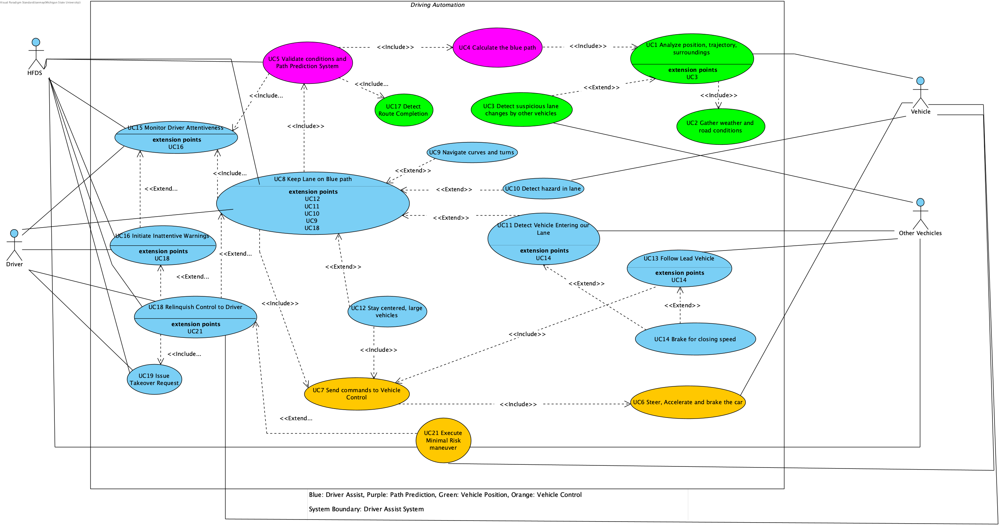

*Figure 4.1: HFDS use case diagram*

Figure 4.1 shows the HFDS use case diagram. The system boundary contains 20 use cases and four actors: the Driver, HFDS, the Vehicle (our car and its sensors and actuators) and Other Vehicles on the road. The use cases fall into five groups.

Engagement – When the Driver asks for hands-free driving, Validate Conditions and Path Prediction System (UC5) evaluates whether HFDS can engage. It consists of Calculate the Blue Path (UC4), Monitor Driver Attentiveness (UC15) and Detect Route Completion (UC17). UC4 involves Analyze Position, Trajectory, Surroundings (UC1), which involves Gather Weather and Road Conditions (UC2). Detect Suspicious Lane Changes by Other Vehicles (UC3) is an extension of UC1. 

Lane keeping – Keep Lane on Blue Path (UC8) is the main use case once the HFDS is engaged. It involves UC5, UC15 and Send Commands to Vehicle Control (UC7). The following four use cases are extensions of UC8 for particular types of roads: Navigate Curves and Turns (UC9), Detect Hazard in Lane (UC10), Detect Vehicle Entering our Lane (UC11) and Stay Centered, Large Vehicles (UC12). 

Speed management – Follow Lead Vehicle (UC13) is responsible for adaptive cruise control and involves UC7. Brake for Closing Speed (UC14) is an extension of UC13 and UC11 where the distance to another vehicle is closing. 

Vehicle control – UC7 comprises Steer, Accelerate, and Brake the Car (UC6), which is the way all the lane-keeping and speed decisions come to the Vehicle.

Driver’s attention and handover – Initiate Inattentive Warnings (UC16) extends UC15 in case of a Driver losing his/her attention. Relinquish Control to Driver (UC18) extends UC8 and UC16 and comprises Issue Takeover Request (UC19). Execute Minimal Risk Maneuver (UC21) extends UC18 if the Driver fails to take control.

**4.2 Use Case Descriptions**

Each use case is described below with the template from the course SRS. Class names refer to the domain model in Section 4.3, and cross-references refer to the requirements in Section 3.

| **Use Case:** | **UC1: Analyze Position, Trajectory, Surroundings** |
| --- | --- |
| **Actors:** | Vehicle |
| **Description:** | During the process of operation of HFDS, the DriverAssistSystem constantly analyzes the data collected by Sensors about the current position and path of the car, about SurroundingVehicles and about each Sensor's health. The results are used during path calculation and all driving decisions. |
| **Type:** | Secondary, essential |
| **Includes:** | UC2 |
| **Extends:** | None |
| **Cross-refs:** | R6, R7, R19, SR4 |
| **Uses cases:** | Included by UC4. Extended by UC3. |
 

| **Use Case:** | **UC2: Gather Weather and Road Conditions** |
| --- | --- |
| **Actors:** | Vehicle, Other Vehicles |
| **Description:** | DriverAssistSystem obtains the current Environment (weather, light conditions, road wetness, and visibility) through the data collected by Sensors and performs Environment.isWithinODD() method to ensure that lanes can still be detected and HFDS can continue working. |
| **Type:** | Secondary, essential |
| **Includes:** | None |
| **Extends:** | None |
| **Cross-refs:** | R13, IR5.1, IR5.4 |
| **Uses cases:** | Included by UC1. |
 

| **Use Case:** | **UC3: Detect Suspicious Lane Changes by Other Vehicles** |
| --- | --- |
| **Actors:** | Other Vehicles |
| **Description:** | During the process of analysis of surroundings, the DriverAssistSystem monitors lanes and lateral speed of each tracked SurroundingVehicle. Erratic lane changes are taken into account during further lane keeping and following decisions. |
| **Type:** | Secondary, optional |
| **Includes:** | None |
| **Extends:** | UC1 |
| **Cross-refs:** | R6, R7 |
| **Uses cases:** | UC1, UC11. |
 

| **Use Case:** | **UC4: Calculate the Blue Path** |
| --- | --- |
| **Actors:** | None (internal) |
| **Description:** | PathPrediction uses VehiclePosition and LiDARMap and invokes calculateBluePath() method to obtain the projected path ("blue path") as an array of map points. Then the path is delivered to the DriverAssistSystem and HFDS is started only on highways where the use of HFDS is enabled according to the map. |
| **Type:** | Secondary, essential |
| **Includes:** | UC1 |
| **Extends:** | None |
| **Cross-refs:** | R2, R9, IR1 |
| **Uses cases:** | Included by UC5. |
 

| **Use Case:** | **UC5: Validate Conditions and Path Prediction System** |
| --- | --- |
| **Actors:** | HFDS (initiated by the Driver’s activation request) |
| **Description:** | If the Driver demands HFDS, validateEngagement() from DriverAssistSystem runs all the necessary tests to make sure Sensors pass their own self test, Environment meets the operational conditions, blue path exists (isPathValid()), LiDARMap is less than seven months old, road is enabled and the Driver is engaged (DriverAttentionSystem.isDriverEngaged()). In case all these tests are passed successfully, HFDS engages and the HumanMachineInterface informs that HFDS is engaged. Otherwise, engagement of HFDS is refused and the HumanMachineInterface displays a Warning message like “Update needed.” |
| **Type:** | Primary, essential |
| **Includes:** | UC4, UC15, UC17 |
| **Extends:** | None |
| **Cross-refs:** | R14, R15, IR1, IR3, IR16 |
| **Uses cases:** | Included by UC8. Sequence diagrams: HFD Activation; SD5 Activation Rejected for Outdated Map. |
 

| **Use Case:** | **UC6: Steer, Accelerate and Brake the Car** |
| --- | --- |
| **Actors:** | Vehicle |
| **Description:** | VehicleControl implements ControlCommands in its methods steer(angle), accelerate(rate) and brake(rate). Acceleration is impossible when the light bar flashes red. Any actions of the Driver through the pedals and steering wheel take precedence over HFDS. |
| **Type:** | Secondary, essential |
| **Includes:** | None |
| **Extends:** | None |
| **Cross-refs:** | R1, IR12, IR13, IR15 |
| **Uses cases:** | Included by UC7. |
 

| **Use Case:** | **UC7: Send Commands to Vehicle Control** |
| --- | --- |
| **Actors:** | None (internal) |
| **Description:** | DriverAssistSystem transforms each lane keeping or speed decision into a ControlCommand and sends it to VehicleControl using sendCommand(cmd). |
| **Type:** | Secondary, essential |
| **Includes:** | UC6 |
| **Extends:** | None |
| **Cross-refs:** | R1 |
| **Uses cases:** | Included by UC8, UC12, UC13. |
 

| **Use Case:** | **UC8: Keep Lane on Blue Path** |
| --- | --- |
| **Actors:** | HFDS, Driver |
| **Description:** | After the successful engagement of HFDS, the DriverAssistSystem starts to call keepLaneCentered() for steering along the blue path with the car’s lateral offset approaching the lane center. The DriverAttentionSystem controls the Driver’s attention all the time. When the Driver steers and then keeps the steering wheel at the same speed, HFDS takes control back. |
| **Type:** | Primary, essential |
| **Includes:** | UC5, UC7, UC15 |
| **Extends:** | None |
| **Cross-refs:** | R18, R20, R39 |
| **Uses cases:** | Extended by UC9, UC10, UC11, UC12, UC18. Sequence diagram: Lane Keeping. |
 

| **Use Case:** | **UC9: Navigate Curves and Turns** |
| --- | --- |
| **Actors:** | None (internal) |
| **Description:** | When there is a bend along the path taken by the blue path, the DriverAssistSystem invokes navigateCurve() to navigate the car along the path. In case the bend is too sharp for HFDS, control passes to the Driver (UC18). |
| **Type:** | Secondary, essential |
| **Includes:** | None |
| **Extends:** | UC8 |
| **Cross-refs:** | R2, R20 |
| **Uses cases:** | UC18. |
 

| **Use Case:** | **UC10: Detect Hazard in Lane** |
| --- | --- |
| **Actors:** | Vehicle |
| **Description:** | In the event the DriverAssistSystem invokes detectHazard() on Sensor and detects a hazard in the lane such as debris, pothole or a vehicle stopped in the lane, the HFDS will not attempt to avoid the hazard. Instead it centers the vehicle, gives a takeover warning and passes the hazard to the Driver (UC18). |
| **Type:** | Secondary, essential |
| **Includes:** | None |
| **Extends:** | UC8 |
| **Cross-refs:** | IR26, R40 |
| **Uses cases:** | UC18, UC19. Sequence diagram: Road Hazard Takeover. |
 

| **Use Case:** | **UC11: Detect Vehicle Entering our Lane** |
| --- | --- |
| **Actors:** | Other Vehicles |
| **Description:** | DriverAssistSystem invokes detectLaneIntrusion(), which utilizes the lateral velocity of the vehicle and the isEnteringLane() of each SurroundingVehicle to detect a cut-in or a drifting vehicle. The vehicle may be the new LeadVehicle. When the gap is reducing rapidly, UC14 takes over. |
| **Type:** | Secondary, essential |
| **Includes:** | None |
| **Extends:** | UC8 |
| **Cross-refs:** | R4, R7 |
| **Uses cases:** | Extended by UC14. Related to UC3. |
 

| **Use Case:** | **UC12: Stay Centered, Large Vehicles** |
| --- | --- |
| **Actors:** | None (internal) |
| **Description:** | In case there is a vehicle in the next lane which is classified as Truck, SemiTruck or Bus, the DriverAssistSystem sets a target offset that makes the car to move slightly away from the vehicle but still within our lane and passes the steering commands through UC7. |
| **Type:** | Secondary, optional |
| **Includes:** | UC7 |
| **Extends:** | UC8 |
| **Cross-refs:** | R6, R20 |
| **Uses cases:** | UC8. |
 

| **Use Case:** | **UC13: Follow Lead Vehicle** |
| --- | --- |
| **Actors:** | Other Vehicles |
| **Description:** | SpeedManagement selects the leader and calculates the trail gap distance that is equal to or greater than the larger of either the Driver’s chosen distance or the 2.0 seconds time at the current speed (and greater behind trucks and semi-trucks and buses). It holds speed in the close zone, coasts with the leader in the coast zone, and applies brakes in the safety zone. When the lead vehicle exits the lane it maintains the set speed up to a maximum of 85 mph. Adaptive Cruise Control is disabled when the Driver applies brakes. |
| **Type:** | Primary, essential |
| **Includes:** | UC7 |
| **Extends:** | None |
| **Cross-refs:** | R4, R5, R17, R21, R24, R25, IR9, IR15 |
| **Uses cases:** | Extended by UC14. Sequence diagram: Following Lead Vehicle. |
 

| **Use Case:** | **UC14: Brake for Closing Speed** |
| --- | --- |
| **Actors:** | None (internal) |
| **Description:** | The SpeedManagement executes brakeForClosingSpeed(). When the closing speed is within the deceleration capabilities of the system, it brakes to slow down at that rate. Otherwise it returns false, and the Driver is warned to regain control of the vehicle (UC18). |
| **Type:** | Secondary, essential |
| **Includes:** | None |
| **Extends:** | UC11, UC13 |
| **Cross-refs:** | R22, R23 |
| **Uses cases:** | UC18, UC19. |
 

| **Use Case:** | **UC15: Monitor Driver Attentiveness** |
| --- | --- |
| **Actors:** | Driver, HFDS |
| **Description:** | DriverAttentionSystem invokes monitorDriver() method to monitor the Driver’s gaze direction and head position using the driver-facing camera. This module also verifies any possible tampering with the camera. If there is any failure with the DriverAttentionSystem module, then HFDS transfers control back to the Driver. |
| **Type:** | Primary, essential |
| **Includes:** | None |
| **Extends:** | None |
| **Cross-refs:** | R27, IR3, SR2, SR5 |
| **Uses cases:** | Included by UC5, UC8. Extended by UC16. |
 

| **Use Case:** | **UC16: Initiate Inattentive Warnings** |
| --- | --- |
| **Actors:** | Driver, HFDS |
| **Description:** | If the function isDriverEngaged() returns false, then the DriverAttentionSystem generates a Class B Warning and raises its priority as the driver does not regain attention. The first warning includes flashing green light bar and “Pay attention to the road” message. The second warning consists of a flashing red light bar along with seat vibration or noise. The last warning involves seat vibration, a verbal command to take control, and a phantom brake pedal application. The timings for the alerts are shown in the sequence diagram of Driver Inattention. If the driver regains control, the alert is cancelled. |
| **Type:** | Secondary, essential |
| **Includes:** | None |
| **Extends:** | UC15 |
| **Cross-refs:** | R29, R30, R31, R32, R36 |
| **Uses cases:** | Extended by UC18. Sequence diagram: Driver Inattention. |
 

| **Use Case:** | **UC17: Detect Route Completion** |
| --- | --- |
| **Actors:** | None (internal) |
| **Description:** | Tests if the car is close to or already at the end of the HFDS-enabling road on the LiDARMap in order for UC5 to either activate or maintain the activation of HFDS. |
| **Type:** | Secondary, essential |
| **Includes:** | None |
| **Extends:** | None |
| **Cross-refs:** | IR1 |
| **Uses cases:** | Included by UC5. |
 

| **Use Case:** | **UC18: Relinquish Control to Driver** |
| --- | --- |
| **Actors:** | Driver, HFDS, Vehicle |
| **Description:** | When the vehicle can no longer be operated safely by HFDS because of hazards in lane, curve being too tight, inadequate braking, sensor failure or any other system malfunction, or unresponsiveness from the Driver, then takeover request is sent (UC19). This is done by the Driver through steering or braking operations which are identified by the methods VehicleControl.detectDriverSteering() and VehicleControl.detectDriverBraking(). The cruise operation is canceled, and control is handed back to the Driver. |
| **Type:** | Primary, essential |
| **Includes:** | UC19 |
| **Extends:** | UC8, UC16 |
| **Cross-refs:** | R22, R23, R40, IR15, IR26, SR5 |
| **Uses cases:** | Extended by UC21. Sequence diagrams: Driver Brakes to Regain Control; Road Hazard Takeover; Sensor Fault. |
 

| **Use Case:** | **UC19: Issue Takeover Request** |
| --- | --- |
| **Actors:** | Driver, HFDS |
| **Description:** | HFDS gives a Class A Warning, “Take steering control immediately.” The Human-Machine Interface turns the light bar to red, inhibition of acceleration occurs, and the Event Log logs the takeover request using logTakeoverRequest(). |
| **Type:** | Secondary, essential |
| **Includes:** | None |
| **Extends:** | None |
| **Cross-refs:** | R22, R23, IR12, IR26 |
| **Uses cases:** | Included by UC18. |
 

| **Use Case:** | **UC21: Execute Minimal Risk Maneuver** |
| --- | --- |
| **Actors:** | Vehicle, Other Vehicles, HFDS |
| **Description:** | In the case when there is no reply from the Driver or he has been identified as inactive, HFDS initiates a slow, controlled stop. If possible, the system moves the vehicle towards the shoulder, while also activating the hazard lights and alerting the responders. |
| **Type:** | Secondary, essential |
| **Includes:** | None |
| **Extends:** | UC18 |
| **Cross-refs:** | R36, SR1, SR6, SR7 |
| **Uses cases:** | Sequence diagrams: Sensor Fault; Driver Inattention. |
A high-level domain model provides the four core ideas of the HFDS: The HFDS as an orchestrator of its various subsystems, the gathering and monitoring of environmental information, the vehicle “thinking” and control, and error logging/handling.

The HFDS consists of the following six functional subsystems: Driver Assist System, Driver Attention System, Vehicle Control System, Human/Machine Interface System, Path Prediction System, and Vehicle Position Subsystem. Each of these subsystems is interconnected with other subsystems and owned by the HFDS. Attributes, methods, and associations of the HFDS, respective subsystems, and all other objects/relationships will be modeled, defined, and documented within the succeeding figures and data dictionary.

Interconnected subsystems make up the core of the HFDS, as shown in Figure ____. The driver will engage with and receive alerts from the HFDS through the Human/Machine Interface subsystem. For safety purposes, the driver will be monitored by the Driver Attention System, receiving up to three alerts for varying levels of inattention.

Environmental data gathered by sensors (see Figure ____) is utilized by the Path Prediction and Vehicle Position subsystems. Path Prediction will provide a blue line path to the Driver Assist subsystem, which will then be validated with the location provided by the Vehicle Position subsystem. If the position and path are valid then the Driver Assist subsystem shall issue control commands to the Vehicle Control subsystem, orchestrating the vehicles movement along the desired path. 

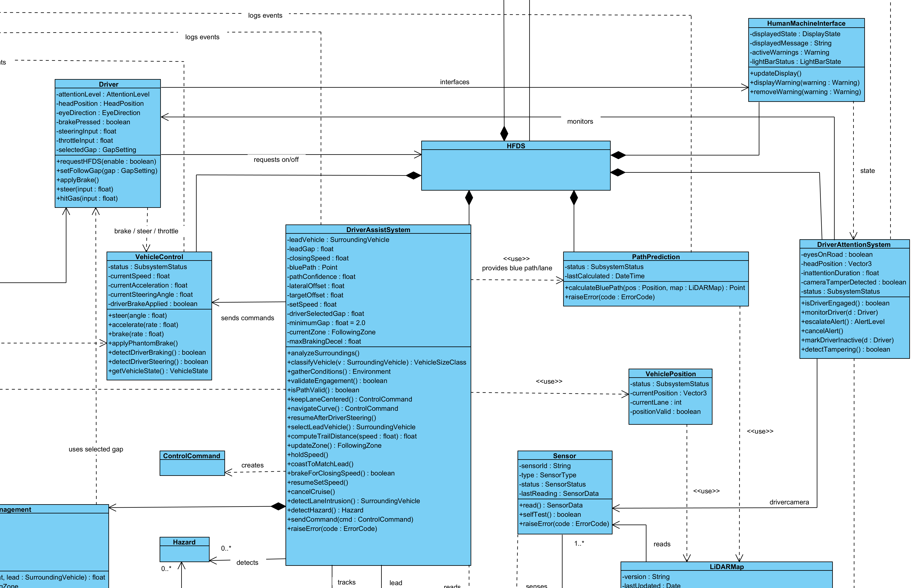Figure ____: Domain Model - HFDS & Subsystems

Environmental data is gathered by sensors. Figure ____ models the Sensor class as well as the classes for critical environmental data. The LiDARMap reads sensor data to capture surrounding information into a map that is then used by the Path Prediction subsystem. Data such as weather, visibility, and road condition are gathered from the sensors in the Environment and Road classes, which are then utilized within the Driver Assist subsystem to validate HFDS engagement. 

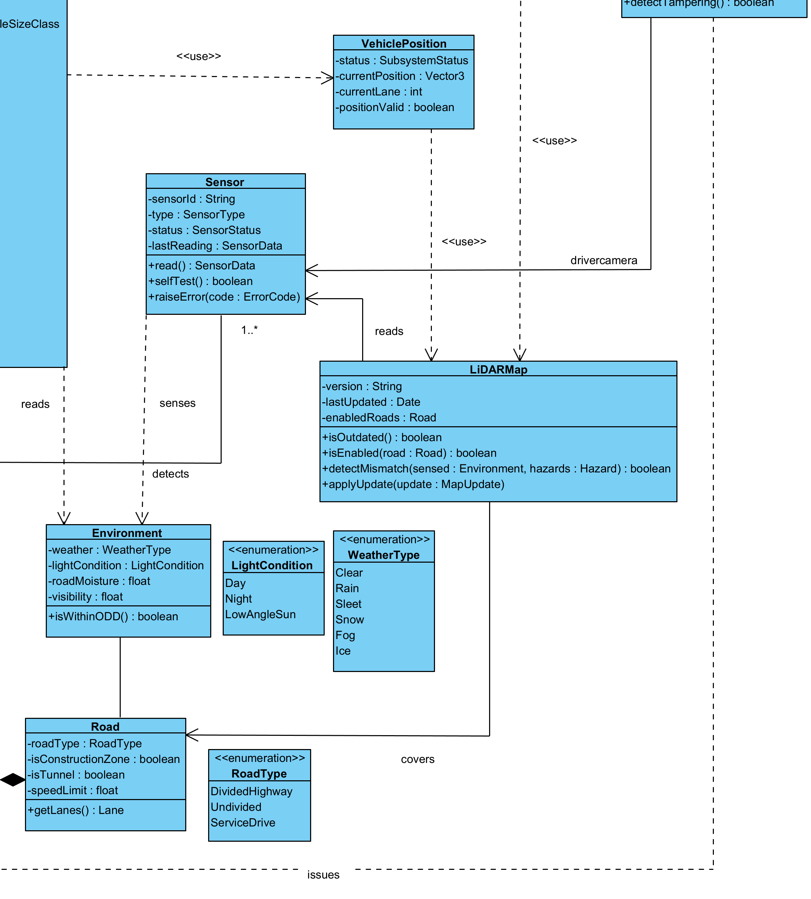

Figure ____: Domain Model - Sensors

Figure ____ models how the Driver Assist subsystem “thinks” for the car to provide HFD. Once sensor data is gathered and modeled within the system, the Driver Assist subsystem tracks road lanes and surrounding vehicles. For the HFDS to utilize ACC a lead vehicle is selected if present, otherwise the HFDS continues at a set speed. The Driver Assist subsystem will perform the necessary calculations with its Speed Management subsystem and issue speed commands to the Vehicle Control subsystem to ensure the vehicle remains at a safe following distance. The Driver Assist subsystem will also utilize sensor data to identify hazards and return control to the driver as necessary.

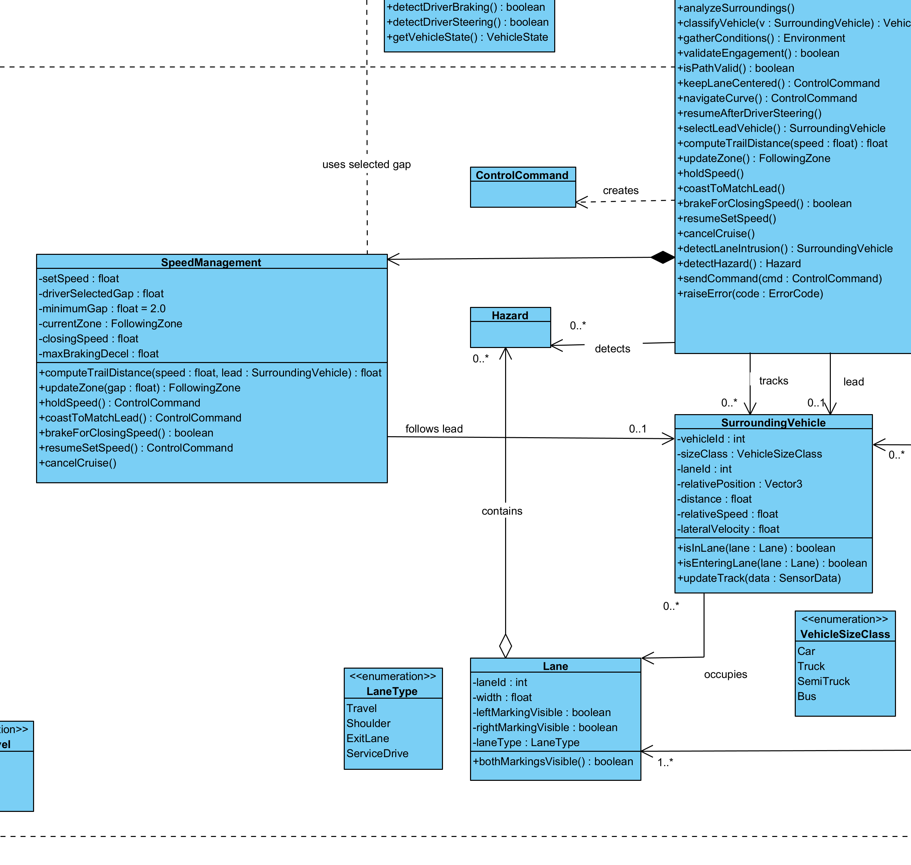Figure ____: Domain Model – Driver Assist & Vehicle Control

Should any subsystem within the HFDS report a confidence level below its threshold, or should an event outside of general vehicle control occur, the occurrence is logged. Modeled by Figure ____.A and ____.B are the EventLog and Warning classes. A Warning is created in response to a system's fault and is always tied to an event log. The Event Log tracks key events such as HFDS activation/deactivation, subsystem faults, hazards, and driver attention warnings. 

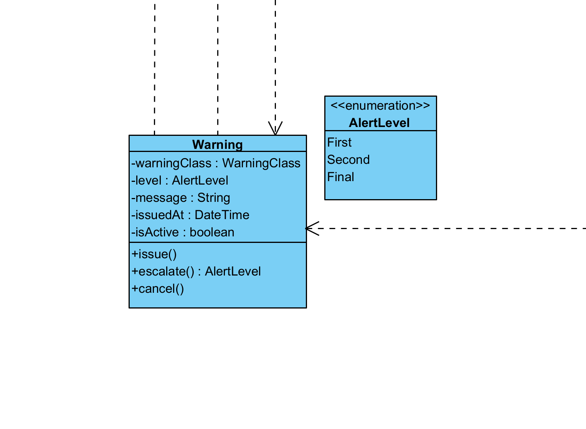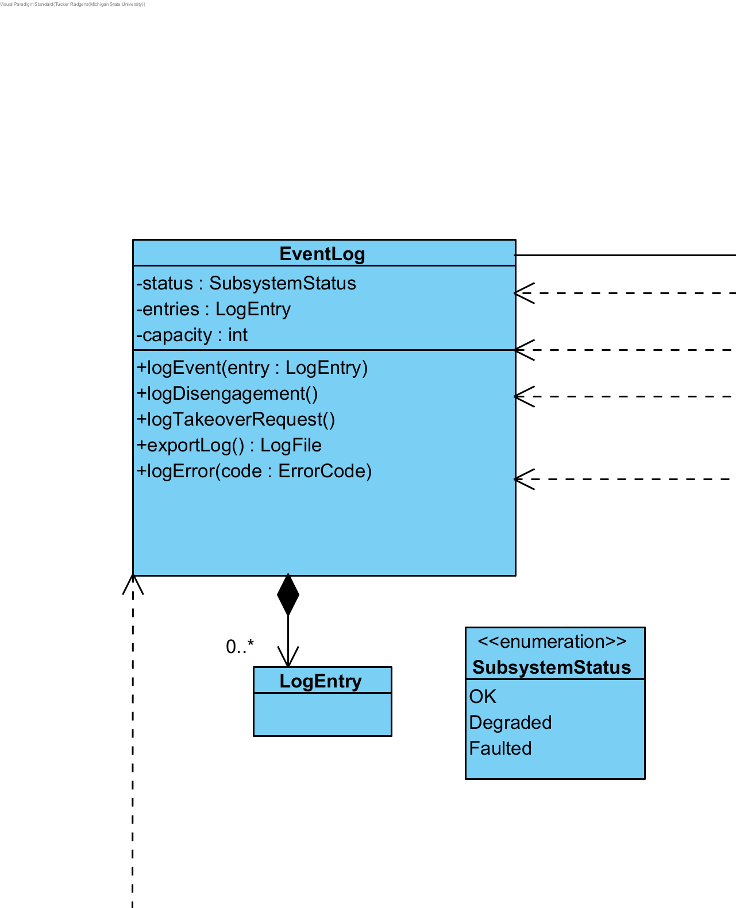

   Figure ____.A : Domain Model – Warning     Figure ____.B: Domain Model - Event

**Data Dictionary:**

| **Element Name** |  | **Description** |
| --- | --- | --- |
| **DriverAssistSystem** |  | The decision-making subsystem. Combines vehicle position, the blue path and surrounding vehicles, and decides how to steer, speed up or slow down. It also holds the blue path, lane following, adaptive cruise control and the lead vehicle, which were separate classes in earlier drafts (R4 to R8, R13, R15, R17 to R25, R39, IR9, UC1, UC7 to UC14). |
| Attributes |   |   |
|   | status: SubsystemStatus | OK, Degraded or Faulted (IR4). |
|   | trackedVehicles: SurroundingVehicle[*] | Vehicles currently tracked around our car (R6, R7). |
|   | leadVehicle: SurroundingVehicle[0..1] | The vehicle directly ahead in our lane that we follow, if there is one (R4). |
|   | leadGap: float | Current distance to the lead vehicle. |
|   | closingSpeed: float | Rate the gap to the lead vehicle is shrinking (R22, R23). |
|   | bluePath: Point[*] | The projected path ("blue path") received from Path Prediction, as a list of map points (R2, R20). |
|   | pathCurvature: float[*] | Curvature at each blue path point, used for curves and turns (UC9). |
|   | pathConfidence: float | How reliable the blue path is, 0 to 1 (R15, UC5). |
|   | lateralOffset: float | Current distance of our car from the blue path / lane center (R20). |
|   | targetOffset: float | Desired offset, e.g. slightly away from a large vehicle in the next lane (UC12). |
|   | setSpeed: float | Adaptive cruise control set speed in mph. Defaults to the current speed when HFDS starts and no speed was set (R17). |
|   | driverSelectedGap: float | Following gap chosen by the driver, in seconds. |
|   | minimumGap: float = 2.0 | Minimum trail distance in seconds of travel time (176 ft at 60 mph) (IR9). |
|   | currentZone: FollowingZone | Which zone the lead vehicle gap is in: Closing, Coast or Safety (R5, R21). |
|   | maxBrakingDecel: float | Braking capability of the system, used to decide between braking and warning the driver (R22, R23). |
| Operations |   |   |
|   | analyzeSurroundings(): void | Continuously analyzes position, trajectory, surrounding vehicles and sensor health while engaged (R19, UC1). |
|   | classifyVehicle(v: SurroundingVehicle): VehicleSizeClass | Classifies a vehicle by size (R6). |
|   | gatherConditions(): Environment | Gathers weather and road conditions (R13, UC2). |
|   | validateEngagement(): boolean | Checks road conditions, trajectory, sensor input and the blue path are safe before engagement (R15, UC5). |
|   | isPathValid(): boolean | True when the blue path is recent and confident and the map is not out of date (UC5, IR16). |
|   | keepLaneCentered(): ControlCommand | Produces a steering command that follows the blue path (R18, R20, UC8). |
|   | navigateCurve(): ControlCommand | Follows the blue path through a bend; hands off to the driver if the curve is too sharp (UC9). |
|   | resumeAfterDriverSteering(): void | Resumes steering once the vehicle is at steady pace and the wheel is held (R39). |
|   | selectLeadVehicle(): SurroundingVehicle | Picks the lead vehicle at a distance that depends on speed and our car's parameters (R4). |
|   | computeTrailDistance(speed: float): float | Returns the required trail distance from speed, the driver gap and the lead vehicle's size class. Larger behind trucks, semi-trucks and buses (R25, IR9). |
|   | updateZone(): FollowingZone | Classifies the current gap into the closing, coast or safety zone. |
|   | holdSpeed(): void | Holds the current speed in the closing zone until the coast zone is reached (R5). |
|   | coastToMatchLead(): void | Coasts to match the lead vehicle's speed before the safety zone (R21). |
|   | brakeForClosingSpeed(): boolean | Brakes at the right rate if the closing speed is within braking capability; returns false if it is not, so a reclaim warning is raised instead (R22, R23, UC14). |
|   | resumeSetSpeed(): void | Returns to setSpeed when the lead vehicle leaves the lane (R24). |
|   | cancelCruise(): void | Cancels adaptive cruise control when the driver brakes (IR15). |
|   | detectLaneIntrusion(): SurroundingVehicle | Detects a vehicle entering our lane, such as a cut-in or a drifting truck (UC11). |
|   | detectHazard(): Hazard | Detects objects in our lane (IR26, UC10). |
|   | sendCommand(cmd: ControlCommand): void | Sends a steering, acceleration or braking command to Vehicle Control (R1, UC7). |
|   | raiseError(code: ErrorCode): void | Reports a fault to the HFDS (Raise Error use case). |
| Relationships | Part of HFDS (composition, 1 to 1). Receives the blue path from PathPrediction. Uses VehiclePosition. Tracks 0..* SurroundingVehicle, and follows 0..1 of them in the role "lead". Detects 0..* Hazard. Reads Environment. Creates ControlCommands and sends them to 1 VehicleControl. |  |
| UML Extensions | Stereotype subsystem. Constraint: trailDistance >= max(driverSelectedGap, minimumGap) x speed (IR9). Constraint: no acceleration while HumanMachineInterface.lightBarState = FlashingRed (IR12). Constraint: lane position from at least two independent sources (SR4.1). Constraint: lead gap measured from at least two independent sources (SR4.2). |  |
 

| **Element Name** |  | **Description** |
| --- | --- | --- |
| **DriverAttentionSystem** |  | Watches the driver's eye movement and head position while HFDS is engaged and decides when attention warnings are needed (R27, R29 to R32, R36, SR2, SR5, IR3). Called DATS in R36. |
| Attributes |   |   |
|   | eyesOnRoad: boolean | Current gaze judgement. |
|   | headPosition: Vector3 | Current head position. |
|   | inattentionDuration: float | Seconds of continuous attention loss, used to escalate alerts. |
|   | cameraTamperDetected: boolean | The driver camera is blocked, faked or manipulated (SR2). |
|   | status: SubsystemStatus | Loss of this system is a single point of failure (SR5). |
| Operations |   |   |
|   | monitorDriver(d: Driver): void | Continuously checks eyes and head (R27). |
|   | isDriverEngaged(): boolean | Used by the HFDS operating constraint (IR3). |
|   | escalateAlert(): AlertLevel | Moves from first to second to final alert while attention loss continues (R29 to R31). |
|   | cancelAlert(): void | Cancels the active alert when the driver re-engages (R32). |
|   | markDriverInactive(d: Driver): void | Marks the driver inactive after the final alert goes unanswered (R36). |
|   | detectTampering(): boolean | Detects camera manipulation (SR2). |
| Relationships | Part of HFDS (composition, 1 to 1). Monitors 1 Driver. Uses 1 driver-facing Sensor (camera). Issues Class B Warnings. Raises ErrorCodes. |  |
| UML Extensions | Stereotype subsystem. Constraint: status = Faulted implies HFDS hands control to the driver (SR5). |  |

| **Element Name** |  | **Description** |
| --- | --- | --- |
| **Environment(Road Conditions)** |  | Current weather, lighting and road surface conditions around the vehicle (R13, IR5.1, IR5.4, UC2). Spelling fixed from the draft "Enviorment". |
| Attributes |   |   |
|   | weather: WeatherType | Clear, Rain, Sleet, Snow, Fog or Ice. |
|   | lightCondition: LightCondition | Day, Night or LowAngleSun (IR5.1). |
|   | roadMoisture: float | Surface wetness level (IR5.4). |
|   | visibility: float | Visibility distance in meters. |
| Operations |   |   |
|   | isWithinODD(): boolean | True when the conditions allow lane detection and HFDS driving (IR5.1, IR5.4). |
| Relationships | Sensed by Sensors. Read by DriverAssistSystem. Checked by HFDS against the operating constraints. Describes conditions on the current Road. |  |
| UML Extensions |  |  |

| **Element Name** |  | **Description** |
| --- | --- | --- |
| **Lane** |  | One travel lane of a road, bounded by lane markings (R18, R20, IR2, IR5.3). |
| Attributes |   |   |
|   | laneId: int | Position on the road. |
|   | width: float | Lane width in meters. |
|   | leftMarkingVisible: boolean | Left lane line detected (IR2). |
|   | rightMarkingVisible: boolean | Right lane line detected (IR2). |
|   | laneType: LaneType | Travel, Shoulder, ExitLane or ServiceDrive (IR5.3). |
| Operations |   |   |
|   | bothMarkingsVisible(): boolean | True when both lines are clearly detected (IR2). |
| Relationships | Part of 1 Road (1..* lanes per road). Our Vehicle occupies 1 Lane. Contains 0..* Hazard. The blue path runs along it. |  |
| UML Extensions | None. |  |
 

| **Element Name** |  | **Description** |
| --- | --- | --- |
| **LiDARMap** |  | The pre-loaded precision LiDAR / HD map with exact lanes, lane markings, barriers and the highways enabled for HFDS (R2, R3, R10, R11, R19, IR1, IR16). |
| Attributes |   |   |
|   | version: String | Map version. |
|   | lastUpdated: Date | Date of the last update. Used for the 7-month age limit (IR16). |
|   | enabledRoads: Road[*] | Divided highways enabled for HFDS (IR1). |
| Operations |   |   |
|   | isOutdated(): boolean | True when older than 7 months (IR16). |
|   | isEnabled(road: Road): boolean | Whether HFDS may operate on a road (IR1). |
|   | detectMismatch(sensed: Environment, hazards: Hazard[*]): boolean | Detects a difference between the map and what the sensors see (R10). |
|   | applyUpdate(update: MapUpdate): void | Installs a downloaded update (R11). |
| Relationships | Created by sensors. Used by PathPrediction and VehiclePosition. Covers 1..* Road. |  |
| UML Extensions | Constraint: {isOutdated() implies HFDS disabled and "Update needed" shown} (IR16). |  |
 

| **Element Name** |  | **Description** |
| --- | --- | --- |
| **PathPrediction** |  | Subsystem that calculates the blue path from Vehicle Position data and the LiDAR map, and enables which highways HFDS may drive on (R2, R9, IR1, UC4, UC5). |
| Attributes |   |   |
|   | status: SubsystemStatus | OK, Degraded or Faulted (R9, IR4). |
|   | lastCalculated: DateTime | When the blue path was last calculated. |
| Operations |   |   |
|   | calculateBluePath(pos: Position, map: LiDARMap): Point[*] | Calculates the projected path as a list of map points and hands it to Driver Assist (R2, UC4). |
|   | raiseError(code: ErrorCode): void | Reports a fault. |
| Relationships | Part of HFDS (composition, 1 to 1). Uses 1 LiDARMap. Uses VehiclePosition. Provides the blue path to DriverAssistSystem. |  |
| UML Extensions | Stereotype «subsystem». |  |
| **Element Name** |  | **Description** |
| **Road** |  | The road the vehicle is driving on (IR1, IR5.2, IR5.3). |
| Attributes |   |   |
|   | roadType: RoadType | DividedHighway, Undivided, ServiceDrive. |
|   | isConstructionZone: boolean | Construction zone present (IR5.2). |
|   | isTunnel: boolean | Tunnel section (IR5.2). |
|   | speedLimit: float | Posted speed limit. |
| Operations |   |   |
|   | getLanes(): Lane[*] | Returns the road's lanes. |
| Relationships | Composed of 1..* Lane. Covered by LiDARMap. Vehicle travels on 1 Road. |  |
| UML Extensions | None. |  |
 

| **Element Name** |  | **Description** |
| --- | --- | --- |
| **Sensor** |  | A physical sensor on the vehicle: front camera, driver camera, radar, LiDAR, GPS receiver, steering wheel grip sensor (R3, R9, R14, R27, R35, SR4, IR5.6). |
| Attributes |   |   |
|   | sensorId: String | Identifier. |
|   | type: SensorType | Camera, DriverCamera, Radar, LiDAR, GPS or GripSensor. |
|   | status: SensorStatus | OK, Obstructed, Damaged or Failed (IR5.6). |
|   | lastReading: SensorData | Most recent measurement. |
| Operations |   |   |
|   | read(): SensorData | Returns the latest measurement (Transmit Environmental Data use case). |
|   | selfTest(): boolean | Checks the sensor works, before engagement and continuously (R14, SR10). |
|   | raiseError(code: ErrorCode): void | Reports a fault (R9). |
| Relationships | Part of 1 Vehicle (1..* sensors). Read by VehiclePosition, DriverAssistSystem and DriverAttentionSystem. Senses Environment. |  |
| UML Extensions | Optional: specialize into Camera, Radar, LiDARSensor and GPSReceiver subclasses instead of using the type attribute. Constraint: {redundant sources for lane position and lead distance} (SR4). |  |

| **Element Name** |  | **Description** |
| --- | --- | --- |
| **VehicleControl** |  | The physical control subsystem. Steers accelerates and brakes based of commands from DriverAssistSystem. Detects driver input on pedals or wheel and returns control. Reports back vehicle's motion.  (R1)(31)(R39)(IR15)(R12)(R40) |
| Attributes |  |  |
|  | status:SubSystemStatus | Tracks subsystem status, Operational/Ok or Degraded/Failed |
|  | currentSpeed: float | Vehicle speed in mph. |
|  | currentAcceleration: float | Acceleration in ft/s²  |
|  | currentSteeringAngle: float | Steering angle in degrees. |
|  | driverBrakeApplied: boolean | True when the driver presses the brake pedal |
| Operations |  |  |
|  | steer(angle: float): void | Moves the steering to the given angle |
|  | accelerate(rate: float): void | Accelerates at the given rate |
|  | brake(rate: float): void | Brakes at the given rate |
|  | applyPhantomBrake(): void | Applies a short brake pulse to get the driver’s attention during the final alert |
|  | detectDriverBraking(): boolean | Detects if driver is braking and returns control if true |
|  | detectDriverSteering(): boolean | Detects if driver is steering and returns control to driver if true |
|  | getVehicleState(): VehicleState | Returns current speed acceleration and steering angle |
| Relationships | Receives ControlCommands from 1 DriverAssistSystem. Provides VehicleState to DriverAssistSystem. Reports driver brake and steering inputs to DriverAssistSystem. |  |
| UML Extensions |  |  |

| **Element Name** |  | **Description** |
| --- | --- | --- |
| **Event Log** |  | Recording subsystem. Tracks all significant events or actions from the HFDS. Used for error diagnosis and performance review of the system.(R45)(R36)(R9)(R41) |
| Attributes |  |  |
|  | status:SubSystemStatus | Tracks subsystem status, Operational/Ok or Degraded/Failed |
|  | entries:LogEntry[*] | Holds all logs  |
|  | capacity:integer | Storage for logs |
| Operations |  |  |
|  | logEvent(LogEntry):void | Log event in the system, timestamp source and type |
|  | logDisengagement():void | Driver is disengaged Log this important event |
|  | logTakeoverRequest():void | Logs takeover request |
|  | exportLog():LogFile | Exports logs for viewing |
|  | logError(ErrorCode):void | Logs an error in the system |
| Relationships | Owns 0..* LogEntry (composition). Receives events from DriverAssistSystem, PathPrediction, VehicleControl. |  |
| UML Extensions | Constraint: every entry has a timestamp |  |

| **Element Name** |  | **Description** |
| --- | --- | --- |
| **Driver** |  | This class will represent the person who will be requesting to use the hands free driving system and select inputs like the follow gap and when to take control back. |
| Attributes |  |  |
|  | attentionLevel: enum | This will store / keep track of the attention level of the driver ie engaged inattentive or inactive ect. |
|  | headPosition:enum | This will track the head position to help determine attention. |
|  | eyeDirection:enum | This will be used to store the current eye position of the person and also used to help determine attention. |
|  | brakePresed: bool | Will be true or false based on if the brakes are being pressed by the driver or not. |
|  | steeringInput: float | How much steering input the driver is putting on the steering wheel. |
|  | throttleInput: float | Will store how much throttle the driver is giving. |
|  | selectedGap:enum | This will store which gap setting the driver has selected. |
| Operations |  |  |
|  | requestHFDS(enable: bool): void | Requestion the HFDS to be turned on or off. |
|  | setFollowGap(enum: float): void | Changes which follow gap setting the user wants. |
|  | applyBrake(): void | Applies the brakes and should deactivate the system |
|  | Steer(input: float): void | Manual steering input takes priority over the HFDS inputs. |
|  | hitGas(input: float): void | Provides the car with acceleration input from the driver which takes priority over the HFDS inputs. |
| Relationships | This class will be connect and interact with HFDS by requesting to turn the system on or off as well as the Vehical control class which will use the steering / braking / accelerating inputs and then the driver assist system will take the in the gap that the driver selects. |  |
| UML Extensions | None. |  |

| **Element Name** |  | **Description** |
| --- | --- | --- |
| **SpeedManagement** |  | Adaptive cruise control component. Holds the set speed and following gap, and decides when to hold speed, coast, brake or resume relative to the lead vehicle (R5, R17, R21 to R25, IR9, IR15, UC14). |
| **Attributes** |   |  |
|  | setSpeed: float | ACC set speed in mph. Defaults to the current speed if none was set when HFDS starts (R17). |
|  | driverSelectedGap: float | Following gap chosen by the driver, in seconds. |
|  | minimumGap: float = 2.0 | Minimum trail distance in seconds of travel time (IR9). |
|  | currentZone: FollowingZone | Closing, Coast or Safety (R5, R21). |
|  | closingSpeed: float | Rate the gap to the lead vehicle is shrinking (R22, R23). |
|  | maxBrakingDecel: float | System braking capability (R22, R23). |
| **Operations** |   |  |
|  | computeTrailDistance(speed: float, lead: SurroundingVehicle): float | Required trail distance from speed, driver gap and the lead vehicle's size class (R25, IR9). |
|  | updateZone(gap: float): FollowingZone | Classifies the current gap into a zone. |
|  | holdSpeed(): ControlCommand | Holds speed in the closing zone (R5). |
|  | coastToMatchLead(): ControlCommand | Coasts to match the lead's speed before the safety zone (R21). |
|  | brakeForClosingSpeed(): boolean | Brakes if within capability. Returns false so a reclaim Warning is raised if not (R22, R23, UC14). |
|  | resumeSetSpeed(): ControlCommand | Returns to setSpeed when the lead leaves the lane (R24). |
|  | cancelCruise(): void | Cancels ACC when the driver brakes (IR15). |
| **Relationships** | Part of DriverAssistSystem (composition, 1 to 1). Reads 0..1 lead SurroundingVehicle. Uses the Driver's selected gap. Produces ControlCommands sent through DriverAssistSystem to VehicleControl. Causes a reclaim Warning when braking is insufficient. |  |
| **UML Extensions** |  |  |

| **Element Name** |  | **Description** |
| --- | --- | --- |
| **SurroundingVehicle** |  | Another vehicle detected around our car, tracked for following, spacing and cut-in detection (R4, R6, R7, R25, UC11, UC12). |
| **Attributes** |   |  |
|  | vehicleId: int | Tracking ID assigned on detection. |
|  | sizeClass: VehicleSizeClass | e.g. Car, Truck, SemiTruck, Bus (R6, R25). |
|  | laneId: int | Lane the vehicle currently occupies. |
|  | relativePosition: Vector3 | Position relative to our car. |
|  | distance: float | Distance from our car. |
|  | relativeSpeed: float | Speed relative to our car. |
|  | lateralVelocity: float | Sideways drift, used to detect lane intrusion (UC11). |
| **Operations** |   |  |
|  | isInLane(lane: Lane): boolean | True if the vehicle occupies the given lane. |
|  | isEnteringLane(lane: Lane): boolean | True if the vehicle is drifting or cutting into the lane (UC11). |
|  | updateTrack(data: SensorData): void | Updates position and speed from new sensor readings. |
| **Relationships** | Tracked by DriverAssistSystem (0..*). 0..1 plays the role "lead" (R4). Occupies 1 Lane. Detected by 1..* Sensor. Used by SpeedManagement for trail distance. |  |
| **UML Extensions** |  |  |

| **Element Name** |  | **Description** |
| --- | --- | --- |
| **Warning** |  | An alert shown to the driver: attention alerts, reclaim/takeover requests and system notices such as "Update needed" (R22, R23, R29 to R32, IR16, UC14). |
| **Attributes** |   |  |
|  | warningClass: WarningClass | Category of warning, e.g. Class B for driver attention. |
|  | level: AlertLevel | First, Second or Final (R29 to R31). |
|  | message: String | Text shown to the driver. |
|  | issuedAt: DateTime | When the warning was raised. |
|  | isActive: boolean | Whether it is still being shown. |
| **Operations** |   |  |
|  | issue(): void | Shows the warning to the driver and logs it. |
|  | escalate(): AlertLevel | Moves to the next alert level (R29 to R31). |
|  | cancel(): void | Clears the warning when the driver responds (R32). |
| **Relationships** | Issued by DriverAttentionSystem (Class B) and DriverAssistSystem (reclaim warnings). Shown to 1 Driver. Final alert triggers VehicleControl.applyPhantomBrake(). Logged by EventLog. |  |
| **UML Extensions** |  |  |

| **Element Name** |  | **Description** |
| --- | --- | --- |
| **HumanMachineInterface** |  | This class handles the driver’s controls and displays status and warnings. |
| Attributes |  |  |
|  | displayedState:enum | This stores the state that is currently being shown to the driver. |
|  | displayedMessage: string | The string message that contains the text that is currently being displayed on screen |
|  | activeWarnings: Warning[*] | Stores a list of warning objects |
|  | lightBarStatus: enum | This stores the current color and pattern of the lightbar. |
| Operations |  |  |
|  | updateDisplay(): void | Updates the light bar and system state. |
|  | displayWarning(warning: Warning): void | This will show the warning or error on screen and update the lights bar. |
|  | removeWarning(warning: Warning): void | This will remove the warning and its alerts |
| Relationships | This class will take in the system state from HFDS and will provide the driver with warnings. |  |
| UML Extensions | None. |  |

| **Element Name** |  | **Description** |
| --- | --- | --- |
| **VehiclePosition** |  | This class will be used to determine where the vehicle is located by using things like GPS and comparing its LiDAR data to the cameras. |
| Attributes |  |  |
|  | Status:enum | This should just store the status of this sub system and if its working correctly or not. |
|  | currentPosition: Vector | This will be a vector that stores the vehicles position probably in longitude and latitude. |
|  | currentLane: int | This will store which lane the car is currently in. |
|  | positionValid: bool | This variable will be used to tell if the vehicle can accurately tell where its at or not. |
| Operations |  |  |
|  | validatePosition(): boolean | Will take in the sensor data and compare against LiDAR and return if the Vehicle can accurately tell where its at. |
|  | updatePosition(): void | This will update the current position of the car based on the sensor readings. |
|  | getPosition(): Vector | This just returns the current position vector |
| Relationships | This class will be connected to HFDS and will use sensor and LiDARMap data to tell where the vehicals position is and what lane its in and PathPredition and DriverAssistSystems will use its position info. |  |
| UML Extensions | None |  |
**4.3 Sequence Diagrams**

**4.3.1 Activating Hands-Free Sriving System**

Figure 1 shows the scenario where the driver activates the HFDS on a supported highway (Scenario 1). Requirements: R14, R15, R47, R48, R49.

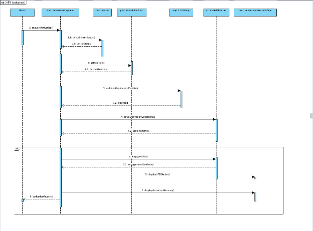*Figure 1: Activating HFDS*

The driver requests activation. The following series of checks is performed: Driver Assist System checking sensor status, Vehicle Control System validating current position with LiDAR map, and Driver Assist & Vehicle Control Systems validating activation conditions. Should all checks be valid, the HFDS is activated and logged. Otherwise, the activation is rejected.  

4.3.2 Lane Keeping

Figure 2 shows how the HFDS keeps the vehicle in its lane while engaged, Requirements: R2, R3, R18, R19, R20.

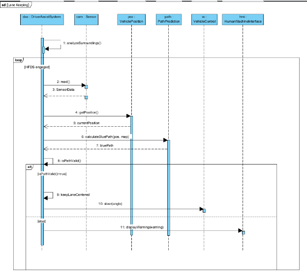*Figure 2: Lane Keeping*

The Driver Assist System is constantly analyzing surroundings by reading sensor data, querying the Vehicle Position System for position, and calculating the blue path via Path Prediction System. If the path is valid, then the Driver Assist System issues lane centering and steering commands to the Vehicle Control System. Otherwise, a warning is displayed.

4.3.3 Following a Lead Vehicle

Figure 3 shows how the HFDS follows a lead vehicle while Adaptive Cruise Control (ACC) is active. Requirements: R4, R5, R21, R22, R23, R24, R25, IR9

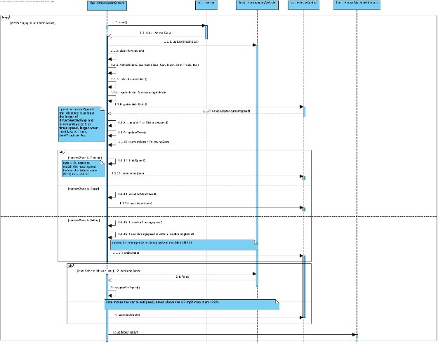*Figure 3: Following a Lead Vehicle*

The Driver Assist System reads sensor data of surrounding vehicles, updating the vehicles it is tracking (classification, sizing, finding lead). With a lead vehicle identified, the Driver Assist System queries the current vehicle state, computing the trail distance zone. If the zone is variable, a speed command (coast/brake/accelerate) is sent to the Vehicle Control System to match the lead vehicle. Otherwise, speed is held. If no lead vehicle is detected or the lead vehicle leaves the lane, a speed command for pre-set HFDS speed is sent to the Vehicle Control System. (Assumes HFDS is activated with ACC).

**4.3.4 Sensor Failure**

Figure 4 shows the fail-safe behavior when a camera, radar, or LiDAR sensor fails. Requirements: R9, R37, R38, SR1, SR4, IR10.

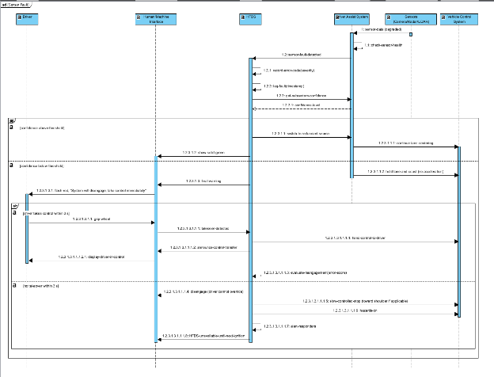*Figure 4: Sensor Failure*

When a sensor detects an internal fault, it is reported to the Driver Assist System, which then performs a validation loop. Once confirmed, the error is raised to the HFDS. The HFDS logs the error and evaluates confidence. If confidence is above threshold, HFD remains enabled. Otherwise, the driver is prompted to take over. If the driver does not take over, the HFDS performs shutdown fallback.

4.3.5 Activation Rejected for an Outdated Map

Figure 5 shows the scenario where the HFDS refuses to engage because the LiDAR map is outdated. Requirements: R10, R49, IR16.

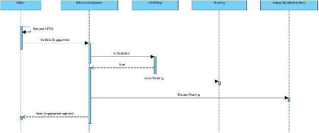*Figure 5:* Cannot activate HFDS because of outdated map

The driver requests HFD. A validation check of the LiDAR mapping is performed by the Driver Assist System. Should the map be outdated HFD engagement is rejected.

4.3.6 Driver Inattention

Figure 6 shows how the alerts escalate when the driver stays disengaged from the road. Requirements: R27 to R31, R36, SR1, SR6, IR12.

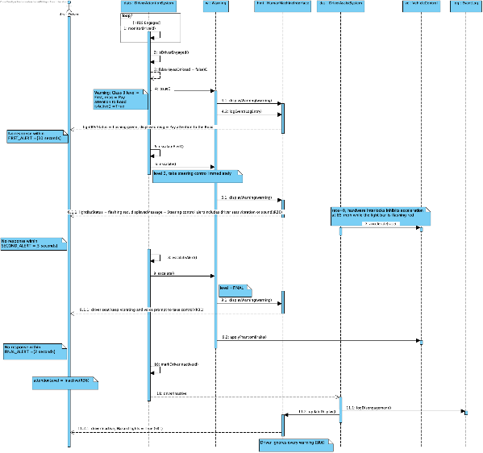*Figure 6: Driver* *Ignores Every Warning*

The Driver Attention System is constantly monitoring the driver's attention. Should the driver become disengaged: An initial warning is displayed by the Human/Machine Interface and logged. If there is no response within the appropriate timeframe, the warning is escalated to level two, with another logging and change of display. If the response to the second alert is not received within the timeframe, a final escalation is logged and displayed. Should the driver not respond to the final warning, a brake and pull over command is sent to the Driver Assist System, the driver is marked as inactive, the hazards are activated, and a disengagement log is filed.

4.3.7 Road Hazard Requires Driver Takeover 

Figure 7 shows how control passes to the driver when a hazard blocks the lane. Requirements: R28, R38, R40, SR1, SR7, IR12, IR13, IR26.

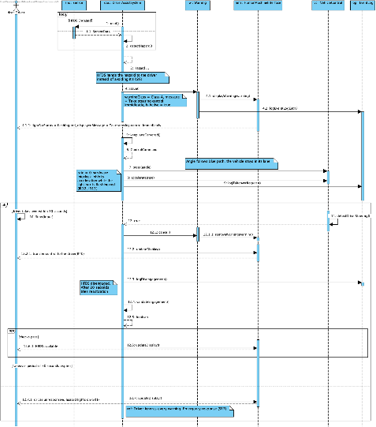

*Figure 7: Road Hazard Requires Driver to Takeover*

The Driver Assist System is constantly querying sensor data attempting to detect a hazard. Once a hazard is detected, a warning is displayed to the Human/Machine Interface and the hazard occurrence is logged. If the driver issues a steering input, the Vehicle Control System detects it and notifies the Driver Assist System, which then: cancels the warning, updates the display, and logs the disengagement of the HFDS which can then be reactivated after 20 seconds. Otherwise, if no steering response is given in the proper amount of time, issues a Class A warning with a flashing red light bar. It holds the lane without accelerating. If the driver steers within 30 seconds, the warning is removed, the HFDS disengages. If not, the controlled stop of SR1 follows.

4.3.8 Driver Brakes to Regain Control

Figure 8 shows the change of control back to the driver when the driver brakes (Scenario 4). Requirements: R50, IR15, IR25.

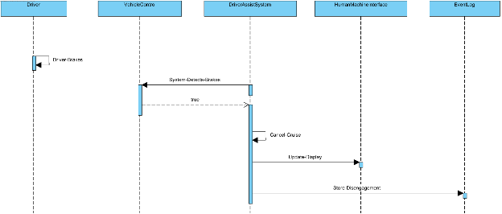*Figure 8:* Driver Presses the Brake to Disengage

Upon driver braking, the Vehicle Control System will detect and inform the Driver Assist System to cancel the cruise control. Once canceled, the Human/Machine Interface will update its display, and the HFDS will log the disengagement.

  - Representative Scenarios of System:

    - Give English descriptions of representative scenarios for each use cases. 

Check: use instances of the class names from class diagram; refer to the terms used in use case diagram

    - For each scenario, give a corresponding sequence diagram

Check: Objects should be instances of classes in class diagram

  - Create and explain a state diagram for all key classes that participate in the scenarios (from above). 

Check: that all scenarios can be validated against the state diagrams.

Check that the events, actions are modeled in the class diagram. 

Check that all variables referenced in the diagrams are declared as attributes in the class diagram. 

Start of your text.

**5** **Prototype** 

Describe what your prototype will show in terms of system functionality.

  1. **How to Run Prototype**

Describe what is needed to run your prototype.

What system configuration? (Should be accessible through web.) Are there plugins? Are there any OS or networking constraints? Give the URL for the prototype. 

Prototype v1 does not have to interactive per se. But there should be sufficient number of interfaces (with descriptive captions/annotations) for the customer to understand the development team’s interpretation of the requirements. All customer-provided scenarios should be included with the prototype. 

Prototype V2 should also be accessible via a webpage. It should be executable and provide an interactive interface. All customer-provided scenarios should be supported and interactive with the prototype. 

  1. **Sample Scenarios**

Give a sample scenario of using your system (from the set of scenarios provided by your customer). Use real data and problem scenarios. Include screen captures illustrating what your prototype produces. As always, be sure to describe all figures.

**6** **References**

Provide list of all documents referenced in the SRS

Identify each document by title, report number, date, and publishing organization.

Specify the sources from which the references can be obtained.

Include an entry for your project website.

Start of your text.

[1] 	D. Thakore and S. Biswas, “Routing with Persistent Link Modeling in Intermittently Connected Wireless Networks,” Proceedings of IEEE Military Communication, Atlantic City, October 2005.

**7** **Point of Contact**

For further information regarding this document and project, please contact **Prof. Betty H.C. Cheng** at Michigan State University (chengb at msu.edu). All materials in this document have been sanitized for proprietary data. The students and the instructor gratefully acknowledge the participation of our industrial collaborators.  

